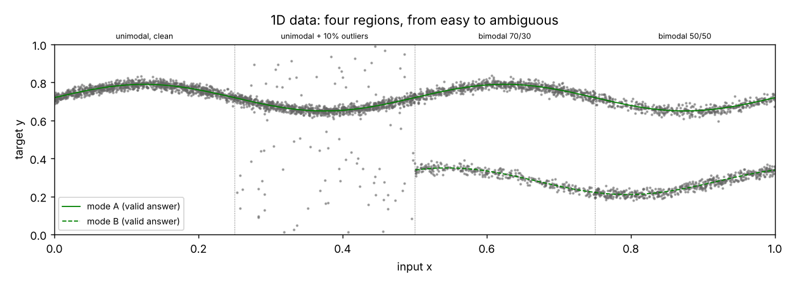
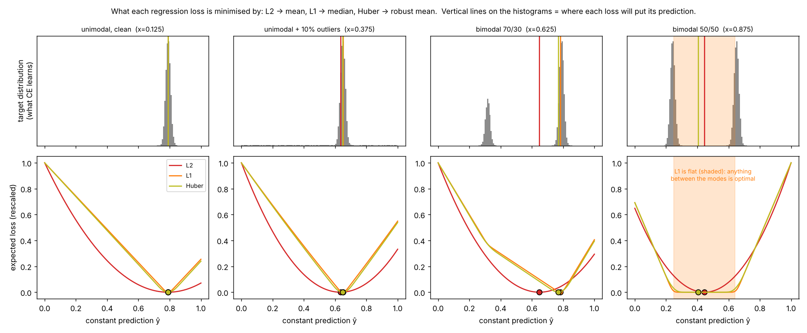
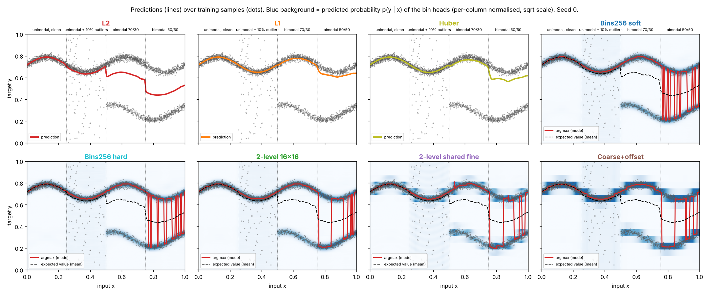
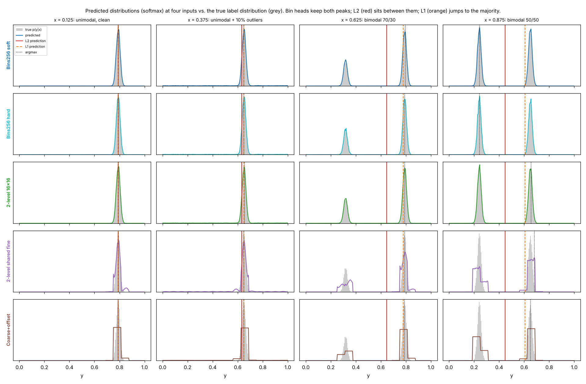
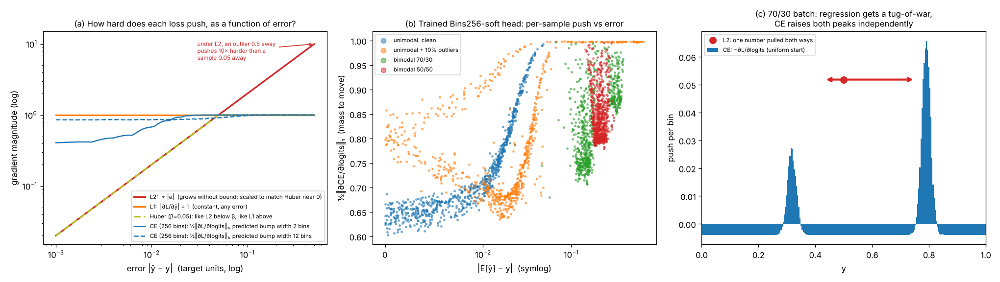
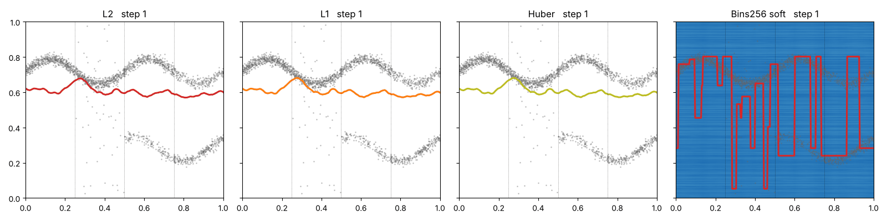
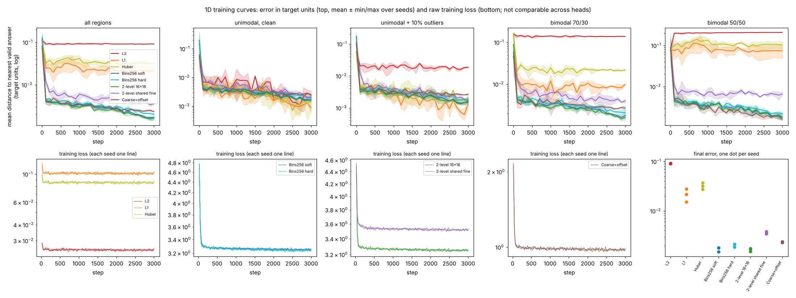
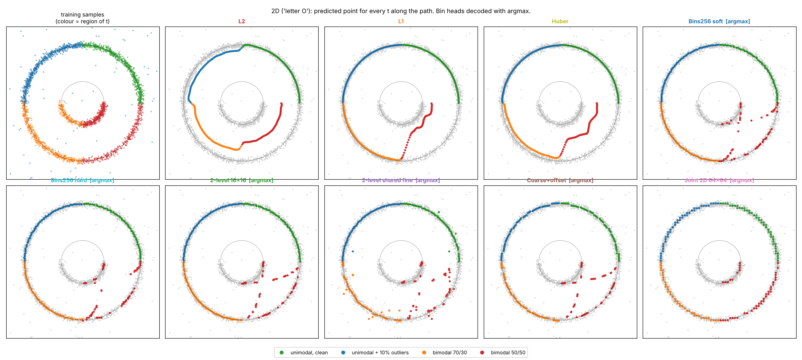
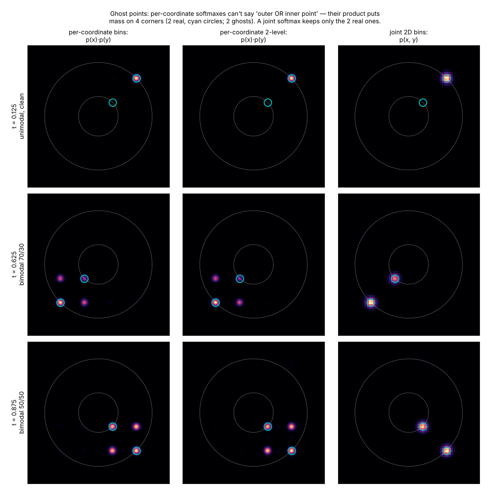

# Regression vs. classification for continuous outputs

**Question:** when a network has to output a number, such as a coordinate of an SVG point, should it *regress* the number (L2 / L1 / Huber) or *classify* it into bins (softmax + cross-entropy)? Why does the choice matter so much when the answer is ambiguous?

```bash
pip install torch numpy matplotlib
python experiment.py              # ~6-10 min on a 4-core CPU: 3 seeds, 17 heads×tasks, all plots + results.md
python experiment.py --quick      # 30 s smoke test
python experiment.py --plots-only # re-draw plots from the saved logs.pkl
```

All heads share **the same backbone**: a 3×128 MLP on Fourier features of the input. Only the last linear layer and the loss change. Training samples are drawn fresh at every step, so there is no overfitting and every head sees exactly the same data stream. The numbers below are means over 3 seeds; the full tables with ± std are in [`results.md`](results.md).

The heads:

| head | output per coordinate | loss | decoding |
|---|---|---|---|
| L2 | 1 number | MSE | the number |
| L1 | 1 number | absolute error | the number |
| Huber | 1 number | Smooth-L1 (β = 0.05) | the number |
| Bins256 soft | 256 logits | CE vs. HL-Gauss soft label (σ = 0.75 bin) | **argmax** (mode) or **expected value** (mean) |
| Bins256 hard | 256 logits | CE vs. one-hot | argmax / mean |
| 2-level 16×16 | 16 coarse + 16×16 fine logits (fine conditioned on coarse) | CE(coarse) + CE(fine \| coarse) | coarse→fine argmax / mean |
| 2-level shared fine | 16 coarse + 16 fine logits (one fine distribution for all coarse bins) | same | same |
| Coarse+offset | 16 coarse logits + 16 offsets | CE + L1 on the offset of the GT bin | argmax bin + its offset / mean |
| Joint 2D 64×64 (2D only) | 4096 logits over (x, y) cells | CE vs. 2D soft label | argmax / mean |

---

## The data



The input x picks one of four regions. In every region the "valid answers" (green) are smooth curves:

1. **unimodal, clean**: one curve plus a little noise. Every method should do well here.
2. **unimodal + 10% outliers**: 10% of labels are replaced by random junk.
3. **bimodal 70/30**: the label is on the upper curve 70% of the time and on the lower curve 30% of the time.
4. **bimodal 50/50**: same, but a coin flip.

Region 3/4 is what an ambiguous annotation looks like: for the *same input* the training set contains two different correct answers. In your SVG setting, this happens whenever a query could plausibly stand for either of two paths, or a closed path could start at either of two vertices.

---

## Finding 1: "L2 predicts the mean, L1 predicts the median". Here is what that looks like.



**How to read it.** Freeze the input x, so the network can only choose one number ŷ. The bottom row shows the average loss over all training labels at that x, for every possible ŷ. The network ends up at the bottom of the curve (dots), and the top row marks where that point lies on the label histogram.

- **L2 (red)** is a parabola whose bottom is the **mean** of the labels. With two clusters of labels the mean falls in the empty gap between them, where *no* training label is. This is not a training failure: it is the exact optimum of the loss.
- **L1 (orange)** is minimised by the **median**. With 70/30 the median is inside the majority cluster, so L1 "snaps" to the 70% mode. With 50/50 the L1 curve is **completely flat** over the whole gap (shaded): every ŷ between the modes is equally good, so where the network ends up depends on initialisation and noise.
- **Huber** behaves like L1 far away and like L2 up close. It is robust to the outliers, but in the bimodal cases it is a compromise between the two.
- **Cross-entropy over bins** has no single "bottom". It is minimised when the softmax *equals* the label histogram in the top row, both peaks included. You decide *afterwards* how to turn that distribution into a number.

The trained networks do exactly what the landscapes predict:



| distance to nearest valid answer (mean) | clean | 10% outliers | 70/30 | 50/50 |
|---|---|---|---|---|
| L2 | 0.0025 | 0.0186 | **0.138** (in the gap) | **0.208** (in the gap) |
| L1 | 0.0009 | 0.0013 | 0.0099 | 0.075 ± 0.021 (wanders, seed-dependent) |
| Huber | 0.0014 | 0.0021 | 0.022 | 0.104 |
| Bins256 soft, **argmax** | 0.0017 | 0.0015 | **0.0018** | **0.0018** |
| Bins256 soft, **mean** | **0.0005** | 0.0174 | 0.138 | 0.207 |

In the plots: the red L2 line drops into the empty space between the two curves as soon as the data becomes bimodal. The orange L1 line stays on the 70% curve, then drifts once the split is 50/50. The bin heads show both curves as two blue ridges of probability; the argmax line jumps between them, but every point it lands on is *a real answer*.

## Finding 2: classification keeps both answers. You choose how to decode them.



This shows the softmax at one input from each region (coloured) on top of the true label histogram (grey). The bin heads reproduce the 70/30 and 50/50 histograms almost exactly, peak heights included. Learning a distribution is the real advantage: the head never has to commit during training, so the two modes never fight over one number.

**The decoding step matters as much as the head:**

- **argmax (mode)** picks one peak. It is always a real answer, never the in-between average. Its accuracy is limited by bin width: one bin is 1/256 ≈ 0.004, so the error never drops much below ~0.001–0.002.
- **expected value (mean)** is *exactly the L2 answer again*: Σ p·center is the mean of the predicted distribution, and the prediction falls into the gap (dashed black lines). On the unimodal clean region it is the **most precise decoder of all (0.0005)**, because it interpolates between bins. On the outlier region it is pulled by the outliers, because the softmax faithfully learned that 10% of labels are junk.
- **In practice:** use argmax (or "mean within a window around the argmax peak") to get the best of both: commit to one mode, then refine within it with sub-bin precision.

## Finding 3: why regression is "finicky" — how hard each loss pushes



- **(a)** The size of the gradient for a given error. **L2's push grows with the error**, so an outlier 0.5 away pulls 10× harder than a sample 0.05 away (and ~30× harder than a typical noisy sample), and a handful of bad labels or bad matches dominates the update. **L1 pushes with constant force** however small the error is, which makes it jittery near the target. **Huber** is L2-like near zero and L1-like far away. **Cross-entropy** is bounded like L1 (at most "move all the probability mass"), so outliers can't explode it.
- **(b)** For the trained bin head, the push per sample never drops to zero, even on clean data. That remainder is the irreducible label noise, and it is balanced across samples.
- **(c)** The key picture: a batch from the 70/30 region. A regression head has **one number**, so the 70% of samples pulling up and the 30% pulling down play tug-of-war, and the rope ends up where the forces balance: the mean (L2) or the median (L1). A bin head has **a separate logit for each place**, so the same batch *raises both peaks independently*. No tug-of-war, nothing to cancel.

This is why regression with Hungarian matching is fragile. Early in training the matching is noisy, so each query effectively sees targets from several GT paths: a multimodal target. L2/L1 then pull the query towards the *average* of those paths, which makes the matching even more ambiguous. A bin head can hold several hypotheses until the matching settles.

## Finding 4: training speed and stability



The GIF shows L2, L1, Huber and Bins256 over training (seed 0). The bin head finds *both* curves within the first ~100 steps; the regression heads settle in the gap or on one curve and stay there.



- In the **clean** region all heads converge at about the same speed. Classification does not "train faster" when the problem is easy.
- In every **ambiguous / noisy** region the bin heads reach their final error within ~100–200 steps; the regression heads never get there, because their optimum is a wrong answer.
- **Seed spread** (bottom right): L1 and Huber vary a lot between seeds (the flat 50/50 landscape again). Bin heads are tight.
- Note that the raw losses (bottom row) are on unrelated scales, which is why every comparison here is in target units.

## Finding 5: multi-level bins — worth it only if done right

| distance to nearest valid answer (mean) | all | 50/50 region |
|---|---|---|
| Bins256 soft | 0.0017 | 0.0018 |
| 2-level 16×16 (fine *conditioned on* coarse) | **0.0017** | **0.0018** |
| 2-level shared fine | 0.0036 | 0.0066 |
| Coarse + offset | 0.0023 | 0.0016 |

- **Conditional 2-level ≡ single softmax.** If the fine distribution depends on the coarse bin, p(c)·p(f|c) can represent anything the 256-way softmax can. With the chain-rule target used here, its loss is *mathematically identical* to the 256-bin cross-entropy. It is a re-parameterisation, so the results match. The only gain is efficiency, and only at very large K: two 64-way softmaxes instead of a 4096-way one.
- **Shared fine bins are cheaper but wrong under ambiguity.** "Where inside the coarse bin" is learned once for all coarse bins. If the two modes sit at different positions inside their coarse bins, the fine distribution has two bumps and argmax applies the wrong one to one of the modes. You can see the duplicated bumps in the purple row of the distributions plot.
- **Coarse + offset** (DORN/Faster R-CNN style) works well: the offset is regressed *per coarse bin*, so each mode gets its own offset and nothing averages. Its weak point is inside one coarse bin, where it is plain regression again.
- **Verdict:** a single 256-way softmax per coordinate is the simplest choice and is cheap at SVG resolutions. Use multi-level only when K gets large (high resolution, or joint 2D bins), and condition the fine level on the coarse one.

## Finding 6 (2D): the "letter O" and ghost points

The input t walks around a path. The target point is on the **outer contour** of an "O". In the two ambiguous quarters it could also be on the **inner contour** (70/30, then 50/50). It is a small version of "is this query the inner or the outer path?".



- **L2** traces a *phantom ring* halfway between the two real contours (red/orange arcs in the gap).
- **L1 / Huber** stay on the outer ring for 70/30, then drift inward for 50/50.
- **Bins (argmax)** land on one of the real contours… *mostly*. In the 50/50 quarter some points sit off both rings. The reason is that x and y have **separate softmaxes**, and each makes its own choice:



With independent softmaxes, the predicted distribution is p(x)·p(y), which has mass on **4 corners: the 2 real points and 2 ghosts** (x from the outer point, y from the inner one). The argmax of x and the argmax of y can land on a ghost. A **joint softmax over (x, y) cells** (right column) holds exactly the two real points.

| 2D, mean distance to nearest valid answer | all | 50/50 region (mean / median) |
|---|---|---|
| L2 | 0.057 | 0.118 / 0.118 |
| L1 | 0.021 | 0.071 / 0.076 |
| Bins256 per-coordinate, argmax | 0.010 | 0.033 / **0.0046** ← mean ≫ median: a minority of ghost points |
| Joint 2D 64×64, argmax | **0.006** | **0.0056 / 0.0057** (no ghosts; floor = coarser 64-bin grid) |

The same thing can happen *across points of a path*: point 3 from one path and point 4 from another. The plan for the real model includes a metric for this.

## Finding 7: what you measure decides who "wins"

"Error vs. the sampled label" (the `err` columns in `results.md`) is almost the same for every head, about 0.10–0.12 on average. The p90 even looks *worse* for bins (0.44 vs. 0.26 for L2). In the 50/50 region, L2 is always half wrong, and argmax is either right or completely wrong (the other mode), so averaged against a coin-flip label they look similar. Only the **distance to the nearest valid answer** (or, for shapes, Chamfer distance / raster IoU) shows that L2 *never* outputs a real shape there and argmax *always* does. For the SVG model, evaluate with geometric metrics against the matched GT and against the set of valid answers, not with per-coordinate error against a single annotation.

---

## One-paragraph summary

Regression heads squeeze everything the data says about a coordinate into one number, and the loss decides which summary you get: the mean (L2), the median (L1) or something in between (Huber). When the label is ambiguous, that summary can be a value no training example ever had, e.g. a point between two paths. A bin head with cross-entropy learns the *whole distribution*: each candidate answer gets its own logits, so they never fight. You then choose the summary at inference: argmax to commit to a real answer, mean (near the peak) for sub-bin precision. Soft (HL-Gauss) labels help a little and give smoother distributions. A single 256-way softmax is enough; multi-level bins are an efficiency trick, not an accuracy trick, and only if the fine level is conditioned on the coarse one. For 2D points, independent per-axis softmaxes can create ghost points, so measure them and use a joint or conditional head if they show up.

## Part 2

See [`PLAN_SVG_ABLATION.md`](PLAN_SVG_ABLATION.md) for how to run this comparison on a MapTR-style SVG model: the bin head with Hungarian matching (NLL vs. expected-coordinate matching cost), cyclic/direction point-order invariance, sampled points vs. Bézier control points, and evaluation (Chamfer, point-error percentiles, raster IoU, ghost/self-consistency checks).

## Files

- `experiment.py`: everything (data, heads, training, metrics, plots).
- `results.md` / `results.json`: all metrics, by head, decoding and region, mean ± std over 3 seeds.
- `plots/`: the figures above, plus `09_predictions_2d_mean_decode.png` (2D bins with mean decoding fall into the gap like L2) and `11_training_curves_2d.png`.
